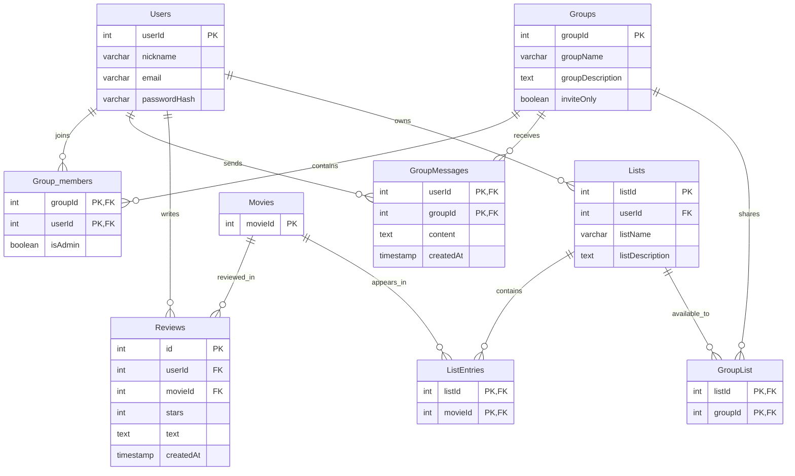

# Vaatimusmäärittely Elokuva yhteisö nettisivu
**Versio:** 0.2
## Tausta
elokuvaharrastustoiminta kerho hajaantunut  
Ryhmä keskustelu, suosittelut hankala seurata  
Muistio ja Listoja  
## palvelu
### Must
- yhteisö ryhmät.
    - Ryhmällä sivu
        - kuvailu
        - jäsenien määrä
    - näkyy elokuvat listat
    - Asetukset
        - Nimeäminen
        - invite only suljettu ryhmä
            - Käyttäjät lähettää kutsun ryhmään
            - pyynnä kutsu, ryhmän jäsenet voi hyväksyä pyynnön. 
        - avoin ryhmä, ei tarvi kutsua
    - ryhmästä lähteminen
    - ryhmä search,
    - ryhmä käyttäjä arvostelut
    - ryhmä chat
        - chat viesti, käyttäjä, teksti, aikaleima
    - ryhmä admin
        - ryhmä admin voi jakaa admin oikeudet
        - voi potkia jäseniä pois ryhmästä
- Käyttäjä tili
    - nickname
    - näkyy julkiset ryhmät
    - tilin poisto
    - muokkaa salasana
    - käyttäjän palautus
- tähti arvostelut 1-5, näkyy arvostelun antaja, aika
    - tarvii käyttäjätilin tekemään arvostelu
    - ei tarvi tekstiä
    - aikaleima
    - pakkaa pitkät arvostelut
- elokuva listat
    - listalle nimi, kuvaus
    - listojen jakaminen, share link
    - ei tarvi käyttäjätiliä näkemään
    - ryhmä listat erikseen
        - ryhmä admin(s) voi muokata
- näkee tuttujen arvostelut
- elokuva haku
- käyttäjä voi heti selata elokuvia ilman kirjautumista

### Should
- ajankohtasia elokuvia, trending
- arvostelu näkyvyys, julkinen, vain ryhmä
- arvostelu muokkaaminen, toinen arvostelu
- suositellut elokuvat, perustuu käyttäjä profiiliin
    - näyttää uusia elokuvia
    - näyttää samanlaisia elokuvia
- haku filtterit,
    - näyttelijät
    - vuosihaku
    - flexible name search
- elokuva info
    - vuosi
    - näyttelijät
    - kesto
    - poster
### Could
- käyttäjä sivu
    - historia
- elokuvateatteri info, Finnkino / Star
    - paikalliset teatterit
    - maholliset filtterit
- maksullinen yhteisö palvelu
- laajentaa elokuvateatterit/tapahtumat
- Elokuvan julkiset arvostelut, rotten tomatoes, imdb etc
- älykkäät toiminnont
    - recommend elokuva
- tilastot
    - elokuvatyypit
- englanti kieli
- ruotsi kieli
- 2FA
- Sivu admin
- elokuva trailer
### non functional
- asiallinen ulkoasu
- phone sivu tuki
- tietoturva, vahva salasana etc
- nopeus < 1s
- suomi kieli
- privacy policy? tarkista gdpr

## tech
- theMovieDB API

# Database

# Muutokset
**28.10.26** Vaatimusmäärittely tehty  
**29.10.26** Määrittely päivitetty asiakas QA:n perusteella  