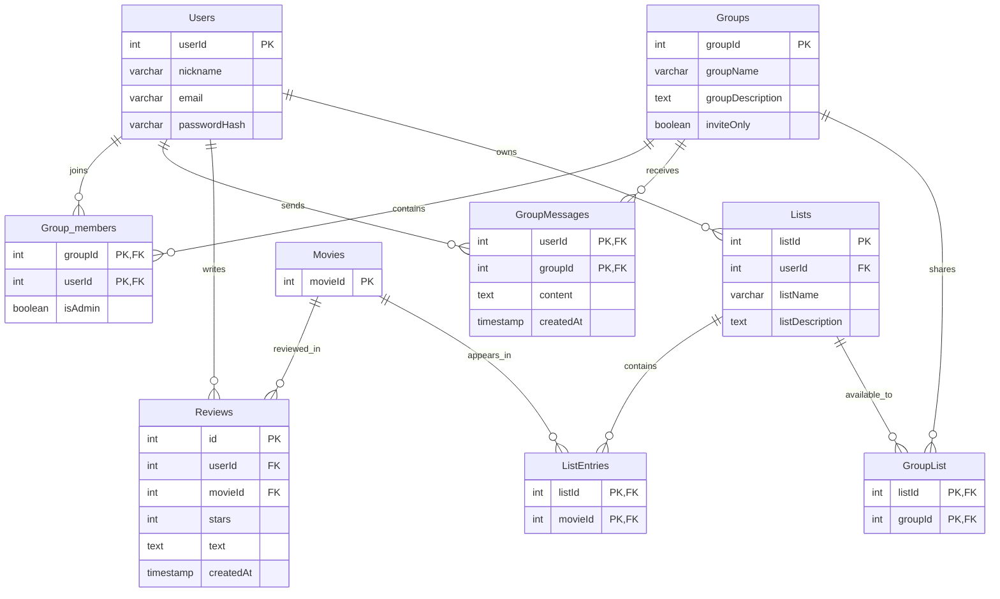

# Vaatimusmäärittely - Elokuvaharrastajien yhteisöllinen nettisivu

**Versio:** 0.3
**Päivämäärä:** 29.10.2026
**Tila:** Luonnos asiakkaalle hyväksyttäväksi

## 1. Tausta ja tavoite

Asiakas on keskustellut elokuvaharrastajien kanssa elokuvista WhatsApp-ryhmässä. Ryhmässä on jaettu suosituksia ja arvosteluja elokuvista. Ryhmässä on myös lisäksi käyty yleistä keskustelua elokuviin liittyen. Keskustelusta on ollut vaikea löytää vanhoja suosituksia ja arvosteluja, sillä ne hukkuvat helposti, kun keskustelua jatketkaan. Lisäksi tällaisessa keskustelussa ryhmän yhteisten elokuvalistojen sekä kiinnostavien elokuvasuositusten seuraaminen on hankalaa.

**Tavoite:** 

- Käyttäjä voi hakea elokuvia ja löytää niiden tiedot ilman, että tarvitsee kirjautua sisään.
- Kirjautunut käyttäjä voi luoda ryhmiä, jossa voi tehdä muiden ryhmäläisten nähtäville käyttöoikeuksien mukaisesti elokuva-arvosteluja, listoja ja käydä keskustelua.
- Kirjautunut käyttäjä voi luoda omia listoja. 
- Palvelua voidaan käyttää tietokoneen sekä puhelimen selaimella.

**2. Käyttäjäroolit**

**Vierailija:**
- Voi hakea ja selata elokuvia ilman käyttäjätiliä.
- Tarkastella julkisia elokuvalistoja sekä muuta sisältöä, jotka ovat määritelty julkisiksi. 

**Kirjautunut käyttäjä:**
- Voi etsiä ryhmiä.
- Voi luoda ryhmiä. 
- Voi liittyä muihin ryhmiin ja poistua niistä.
- Voi luoda omia elokuvalistoja sekä elokuva-arvosteluja. 

**Ryhmän ylläpitäjä**
- Voi hallita oman ryhmän listoja ja jäseniä.
- Voi lisätä muita ryhmän jäseniä ylläpitäjiksi. 

## Toiminnalliset vaatimukset

### Must - Pakolliset ominaisuudet

#### Yhteisöryhmät

    - Ryhmällä oma sivu, jossa näytetään ryhmän kuvaus ja jäsenmäärä.
    - Ryhmän sivulla näytetään ryhmän omat elokuvalistat.
    - Ryhmän asetuksissa voidaan määritellä seuraavaa:
    - Ryhmän nimeäminen.
    - Ryhmän näkyvyys - invite only. 
        - **Avoin:** Käyttäjä voi liittyä ilman kutsua.
        - **Suljettu:** Ryhmään liittyminen edellyttää liittymispyyntöä tai kutsua.

**Käyttäjä voi:**  

    - Lähteä ryhmästä.
    - Etsiä ryhmiä.
    - Ryhmän jäsenet voivat tarkastella ryhmän sisäisiä arvosteluja.
    - Ryhmällä on keskustelu, jossa näkyvät viestin lähettäjä, viestin sisältö ja aikaleima. 
    - Ryhmän ylläpitäjä voi antaa ylläpitäjäoikeuksia toiselle ryhmän jäsenelle.
    - Ryhmän ylläpitäjä voi poistaa jäseniä ryhmästä esimerkiksi sääntörikkomusten vuoksi. 

#### Käyttäjätili

    - Käyttäjällä on yksilöllinen nimimerkki. 
    - Käyttäjäprofiilissa voidaan näyttää käyttäjän julkiset ryhmät. 
    - Käyttäjä voi poistaa oman tilinsä.
    - Käyttäjä voi vaihtaa omaa salasanaa.
    - Käyttäjä voi pyytää salasanan palautusta.

#### Elokuva-arvostelut

- Kirjautunut käyttäjä voi antaa elokuvalle arvosanan: asteikolla 1-5 tähteä.
- Arvostelussa näkyvät nimimerkki sekä aikaleima.
- Arvostelun lisääminen ei edellytä tekstimuotoista kommentin lisäystä. 
- Käyttäjän tulee olla kirjautunut sisään antaakseen elokuvalle arvostelun. 
- Pitkät tekstimuotoiset arvostelut voidaan näyttää lyhennettyinä esikatseluina. 

**Elokuvalistat:**
 
 - Käyttäjä voi luoda elokuvalistan, antaa sille nimen ja kuvauksen sekä myös lisätä elokuvia.
 - Käyttäjä voi jakaa listan linkillä.
 - Julkiset tai linkillä jaettavia listoja voi tarkastella ilman kirjautumista. 
 - Ryhmillä voi olla omia yhteisiä elokuvalistoja.
 - Ryhmän ylläpitäjä voi muokata ryhmän yhteisiä listoja.

 **Elokuvien selaaminen ja hakeminen:**

 - Käyttäjä voi selata elokuvia ilman kirjautumista.
 - Käyttäjä voi hakea elokuvia.
 - Käyttäjä voi tarkastella tuttujen käyttäjien arvosteluja sovittujen näkyvyysasetusten mukaisesti. 

### Should - Tärkeät lisäominaisuudet

- Ajankohtaisten ja suosittujen elokuvien näyttäminen.
- Arvostelujen näkyvyyden määrittäminen julkiseksi tai vain tietyn ryhmän nähtäväksi.
- Oman arvostelun muokkaaminen tai uuden arvostelun antaminen aiemman tilalle.
- Elokuvasuositukset käyttäjän profiilin tai mieltymysten perusteella: 
    - Uusien elokuvien ehdottaminen.
    - Samankaltaisten elokuvien ehdottaminen.

- Elokuvahaun suodattimet:
    - näyttelijät
    - julkaisuvuosi
    - joustava nimihaku

- Elokuvan lisätiedot:
    - julkaisuvuosi
    - näyttelijät
    - kesto
    - julistekuva

### Could - Mahdolliset lisäominaisuudet

- Käyttäjäprofiili, jossa näytetään katseluhistoria.
- Elokuvateattereiden, kuten Finnkinon ja Starin tiedot.
- Paikallisten elokuvateattereiden ja tapahtumien hakeminen ja suodattaminen.
- Kaupalliset ominaisuudet tulevaisuudessa.
- Ulkoisten elokuva-arvosteluiden, kuten IMDb:n tai Rotten Tomatoesin arvostelujen näyttäminen.
- Älykkäät elokuvasuositukset tai tekoälyyn perustuva suositustoiminto. 
- Käyttäjän elokuvamieltymyksiin liittyvät tilastot, kuten suosituimmat elokuvatyypit. 
- Englannin ja ruotsin kieliversiot.
- Kaksivaiheinen tunnistautuminen (2FA).
- Erillinen palvelun ylläpitäjän näkymä. 
- Elokuvatrailereiden näyttäminen tai niihin linkitys. 

### Non-functional - Ei-toiminnalliset vaatimukset

**Käytettävyys:** Käyttöliittymän tulee olla selkeä ja helppokäyttöinen.
**Responsiivisuus:** Palvelun tulee toimia sekä tietokoneen että puhelimen selaimessa.
**Tietoturva:** Salasanat tulee tallentaa turvallisesti tiivistettyinä sekä käyttäjien oikeudet tulee tarkistaa palvelimella. 
**Suorituskyky:** Tavoitteena on alle sekunnin latausaika keskeisille toiminnoille määritellyissä testiolosuhteissa.
**Kieli:** Ensimmäinen versio toteutetaan suomeksi.
**Tietosuoja:** Henkilötietojen käsittely, tietojen säilytys ja käyttäjätilin poistaminen toteutuu sovellettavien tietosuojavaatimusten mukaisesti. 

## Tech

- **Elokuvatietojen lähde:** theMovieDB API

# Database

# Asiakkaan hyväksyntä ja muutosten hallinta

Vaatimusmäärittely käydään läpi yhdessä asiakkaan kanssa. Hyväksynnällä varmistetaan, että projektin tavoitteet ja toiminnallisuudet vastaavat asiakkaan tarpeita. 

**Hyväksyjä (asiakas)**:
**Päivämäärä:**
**Päätös:**
**Huomautukset ja sovitut muutokset:**

# Muutokset

**28.10.2026** Vaatimusmäärittely tehty  
**29.10.2026** Määrittely päivitetty asiakas QA:n perusteella
**29.10.2026** Taustaa ja tavoitteita täsmennetty. Käyttäjäroolit lisätty ja toiminnallisten vaatimusten rakennetta selkeytetty. Vaatimusten kuvauksia ja priorisointia yhdenmukaistettu sekä ei-toiminnallisia vaatimuksia täsmennetty. 'Asiakkaan hyväksyntä ja muutosten hallinta' -kohta lisätty. 